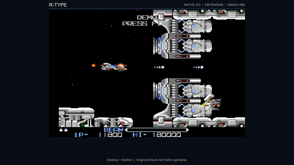
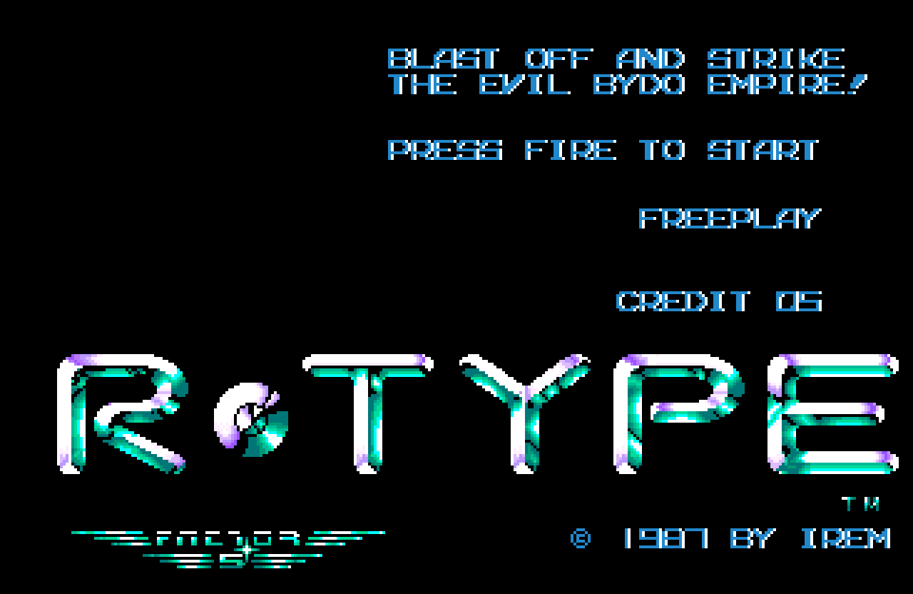
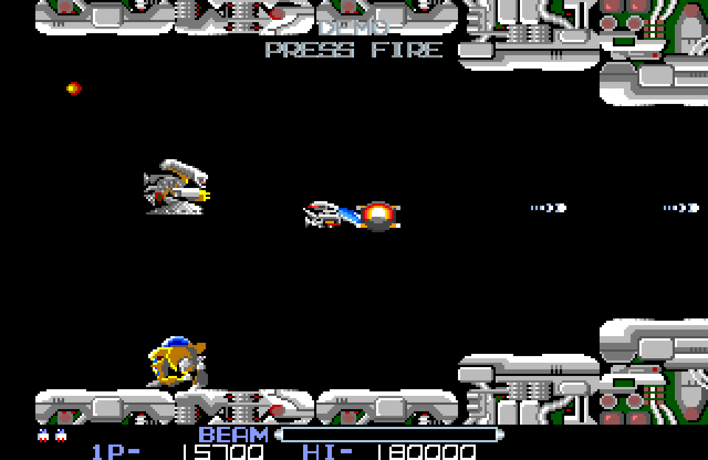
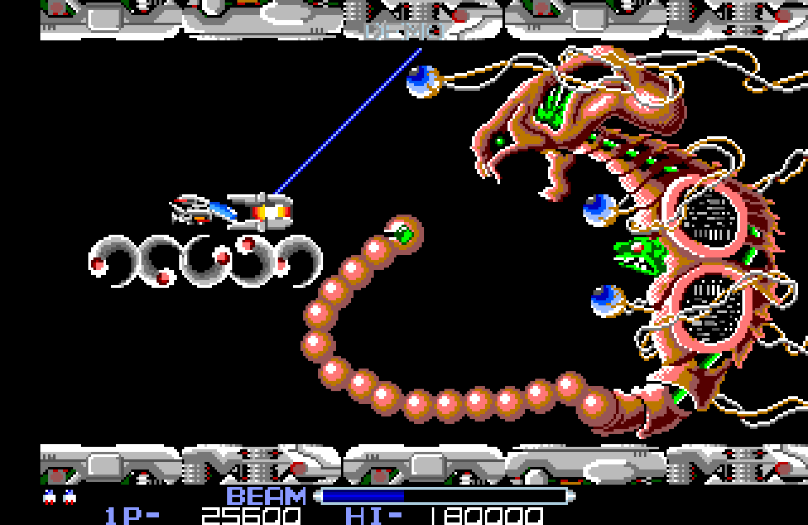
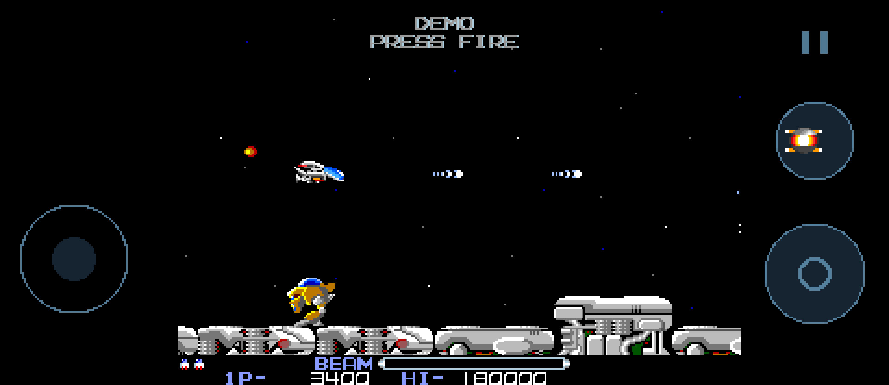

# R-Type Go

A native Go/Ebitengine remake of the Amiga edition of **R-Type** for desktop and
Android. All eight stages, authored formations, weapons, Force behavior, bosses,
checkpoint scenes, records and the ending run as native Go game logic.



[Watch the complete first-stage presentation](media/rtype-presentation.mp4)

| Animated title | Stage one |
| --- | --- |
|  |  |

| Dobkeratops | Android controls |
| --- | --- |
|  |  |

## Prepare the resources

The original ADF and generated runtime assets are not included. Follow
[the extraction guide](docs/ASSET_EXTRACTION.md) before playing.

## Desktop

Go 1.26 or newer and the normal Ebitengine desktop prerequisites are required.

```sh
go run ./cmd/extract -adf "/path/to/R-Type.adf" -out assets/runtime
go run ./cmd/rtype
```

Useful commands:

```sh
go run ./cmd/rtype -touch
go run ./cmd/rtype -mute
go run ./cmd/buildmedia
```

## Controls

| Action | Keyboard | Standard gamepad |
| --- | --- | --- |
| Move | Arrow keys or WASD | Left stick or D-pad |
| Fire and charge | Z or right Ctrl | South button |
| Release charged beam | Release Fire | Release South button |
| Launch or recall Force | X or Space | West button |
| Start | Enter or Fire | Start or South button |
| Pause or resume | P | Select |
| Pause, then return to title | Escape | Android system Back |
| Fullscreen | F11 | — |

After 20 seconds without input on the title, the expert demonstration clears the
first stage with normal controls. Any key, click, touch or gamepad action starts
a new game; Back returns the demonstration to the title.

## Android

```sh
go run ./cmd/buildandroid -target android/arm64,android/amd64
```

The debug APK is written to `bin/rtype-debug.apk`. Android places a directional
pad on the left and Fire, Force and Pause buttons on the right. Multiple fingers
can move and charge simultaneously. Focus loss cancels held input and pauses.

## Presentation media

The media command records the game renderer and native sound directly, then
creates MP4, WebM, captions and poster files with FFmpeg:

```sh
go run ./cmd/buildmedia
```

## Original game credits

R-Type was created by Irem. The Amiga edition was published by Electric Dreams.
The original name, program, graphics, music, audio and game data remain the
property of their respective copyright holders. This independent fan remake is
not affiliated with or endorsed by the original rights holders.

